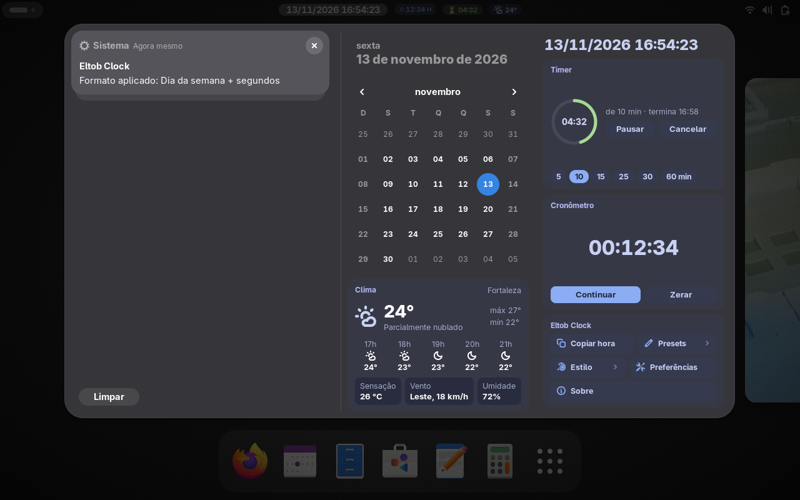
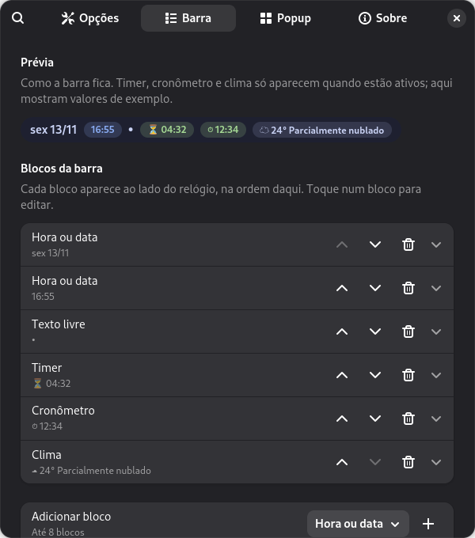
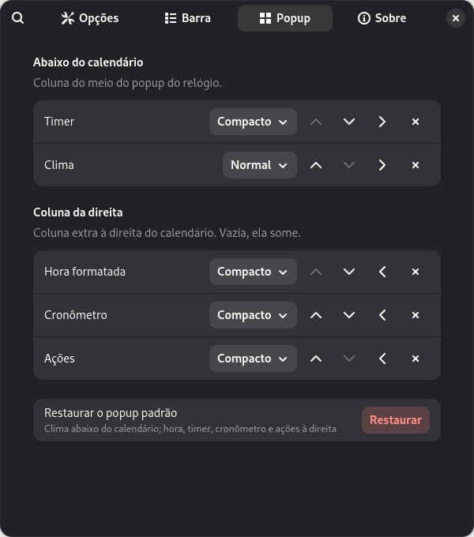
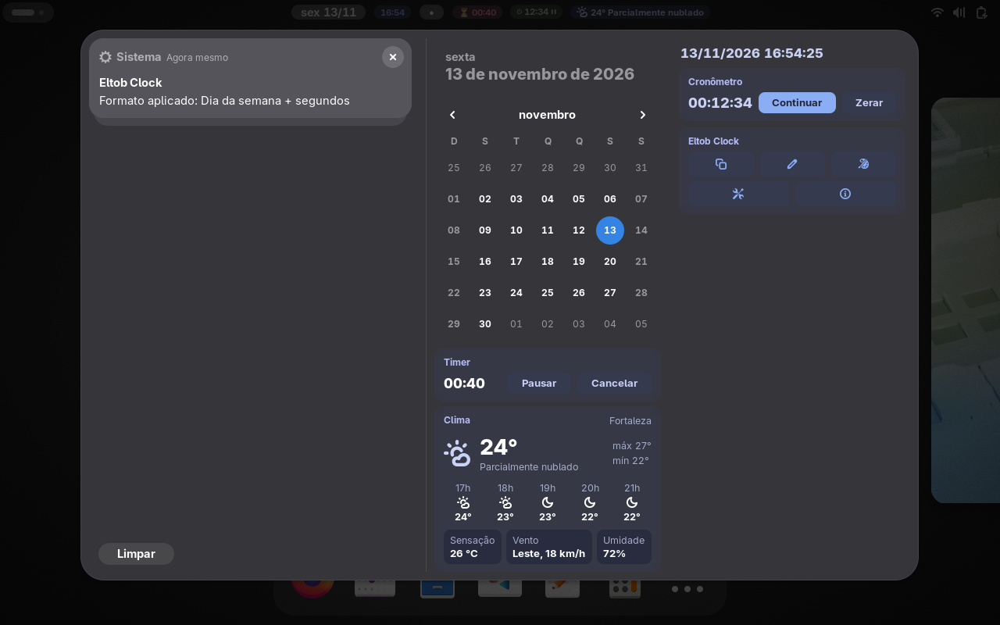

# Eltob Clock

Relógio da barra do GNOME **configurável**: você escolhe o formato e a composição do que fica na barra e o layout do popup, com **timer**, **cronômetro** e **clima**. Visual da família Eltob Indicator (Catppuccin Macchiato, acento azul).

Fork do [Numeric Clock](https://github.com/nickotmazgin/Linux-Numeric-Date-And-Clock) de Nick Otmazgin (MIT). O núcleo que troca o texto do relógio vem dele; o popup, o timer, o cronômetro, o clima, o layout editável e o visual são novos.



*As capturas usam dados de exemplo no clima (gerados num GNOME 50 isolado).*

## O que faz

- **Barra por blocos:** hora ou data (cada uma com formato strftime próprio), timer, cronômetro, clima e texto livre, na ordem que você quiser, cada bloco como texto ou pílula colorida. Se algum bloco mostra segundos, o relógio anda a cada segundo.
- **Popup em 3 colunas:** notificações, calendário e clima, e uma coluna nova com hora formatada, timer, cronômetro e ações. Os eventos e relógios mundiais nativos ficam escondidos (voltam ao desativar a extensão).
- **Layout do popup editável:** cada cartão (hora, timer, cronômetro, clima, ações) pode ficar abaixo do calendário, na coluna da direita ou escondido, em tamanho normal ou compacto, na ordem que você escolher.
- **Transições suaves:** pílulas, listas que abrem, timer e clima aparecem e crescem com animação, e o popup acompanha. Respeita a opção de animações do GNOME.
- **Timer:** 5, 10, 15, 25, 30 e 60 min, com anel de progresso (verde, amarelo abaixo de 25 %, vermelho abaixo de 10 %), pausar, retomar e cancelar. Ao terminar: notificação e som do sistema.
- **Cronômetro:** iniciar, pausar, continuar e zerar.
- **Clima:** temperatura, condição, máx/mín, previsão por hora, sensação, vento e umidade, pelo serviço de clima do próprio GNOME (libgweather) e localização automática (GeoClue).
- **Formato livre (strftime)** com prévia ao vivo e 8 presets; tique exato na virada do segundo.

### Editor nas preferências

| Barra | Popup |
|---|---|
|  |  |

Layout personalizado (barra com blocos próprios e cartões compactos):



## Requisitos

- GNOME Shell 45 a 51 (testado no 50.6, Fedora 44, Wayland).
- Para o clima: GNOME Weather instalado e Serviços de localização ativos em Configurações, Privacidade. Ao iniciar, a extensão liga a opção "localização automática" do clima do GNOME (dá para desligar nas preferências).

## Instalar

```bash
git clone https://github.com/eltobsjr/eltob-clock.git
cd eltob-clock
./tools/build.sh
gnome-extensions install --force dist/eltob-clock@eltobsjr.gmail.com.v*.shell-extension.zip
gnome-extensions enable eltob-clock@eltobsjr.gmail.com
```

No Wayland, saia e entre na sessão para o GNOME carregar a extensão. Ela **substitui** o Numeric Clock: não deixe os dois ativos.

## Desenvolvimento

| Comando | O que faz |
|---|---|
| `./tools/build.sh` | gera o zip em `dist/` |
| `./tools/validate.sh` | confere o zip e o `metadata.json` |
| `node tools/tests/timerlogic.test.mjs` | testa a lógica do timer e do cronômetro |
| `node tools/tests/layoutlogic.test.mjs` | testa as regras do layout (blocos da barra e cartões do popup) |
| `EC_SHOT_DIR=/pasta ./tools/prefs-shots.sh` | salva capturas das páginas Barra e Popup das preferências |
| `./tools/prefs-test.sh` | testa a janela de preferências (gjs) |
| `./tools/nested-smoke-test.sh` | carrega a extensão num GNOME Shell isolado (`--headless`) e roda os testes de interface; com `EC_SHOT_DIR=/pasta` também salva capturas de tela |

Estrutura: `src/extension.js` (texto da barra e injeção no popup), `popup.js` (cartões e montagem das colunas), `barcomposer.js` (blocos da barra), `layoutlogic.js` (regras do layout), `labs.js` (editor nas preferências), `anim.js` (transições), `weatherview.js` (clima), `clockstate.js` e `timerlogic.js` (timer e cronômetro), `prefs.js` e `presets.js`.

## Privacidade

Tudo é local. Veja [PRIVACY.md](PRIVACY.md).

## Créditos e licença

MIT. Copyright (c) 2025 Nick Otmazgin (Numeric Clock, a base deste fork) e (c) 2026 Eltob. Veja [LICENSE](LICENSE).
